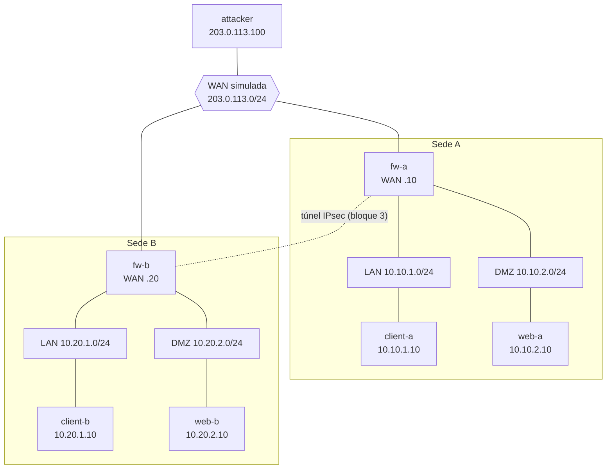

# Laboratorio de segmentación y firewall / Segmentation and firewall lab

**ES:** Laboratorio reproducible con Docker que recrea una arquitectura de dos sedes con zonas (LAN y DMZ), firewalls Linux (nftables) y un túnel IPsec (strongSwan), validado con un contenedor atacante (nmap). Todo corre aislado, sin salida a internet.

**EN:** Reproducible Docker lab that recreates a two-site architecture with zones (LAN and DMZ), Linux firewalls (nftables) and an IPsec tunnel (strongSwan), validated with an attacker container (nmap). Everything runs isolated, with no internet access.

## Requisitos
- Docker Desktop
- WSL2 
- Soporte de XFRM

## Estado / Status

- [x] Bloque 1: topología base (redes, contenedores, enrutamiento) / Base topology
- [x] Bloque 2: política del firewall con nftables (denegar por defecto) / Default-deny firewall policy
- [x] Bloque 3: túnel IPsec entre sedes / Site-to-site IPsec tunnel
- [x] Bloque 4: pruebas con nmap y evidencias / nmap validation and evidence

## Topología / Topology

| Zona | Red | Equipos |
|---|---|---|
| WAN simulada | 203.0.113.0/24 | fw-a (.10), fw-b (.20), attacker (.100) |
| Sede A, LAN | 10.10.1.0/24 | client-a (.10), fw-a (.254) |
| Sede A, DMZ | 10.10.2.0/24 | web-a (.10), fw-a (.254) |
| Sede B, LAN | 10.20.1.0/24 | client-b (.10), fw-b (.254) |
| Sede B, DMZ | 10.20.2.0/24 | web-b (.10), fw-b (.254) |



## Uso / Usage

```powershell
docker compose up -d --build
docker compose ps
docker compose down        # detener y eliminar el laboratorio
```

## Verificación del bloque 1 / Block 1 checks

```powershell
docker exec fw-a ip -br addr
docker exec fw-a cat /proc/sys/net/ipv4/ip_forward      # 1
docker exec client-a ping -c 2 10.10.1.254              # llega a su firewall (OK)
docker exec client-a ping -c 2 10.10.2.10               # LAN -> DMZ pasa por fw-a (OK, aún sin reglas)
docker exec client-a ping -c 2 10.20.1.10               # otra sede: debe FALLAR hasta tener el túnel
docker exec attacker ping -c 2 203.0.113.10             # atacante ve el firewall (OK)
docker exec attacker ping -c 2 10.10.2.10               # atacante a la DMZ: debe FALLAR
```

## Verificación del bloque 2 / Block 2 checks

```powershell
docker exec client-a wget -q -O /dev/null -T 3 http://10.10.2.10                            # LAN -> web: sin salida = OK
docker exec client-a wget -q -O /dev/null -T 3 http://10.10.2.10:8080                       # otro puerto: "timed out" = bloqueado
docker exec web-a ping -c 2 -W 2 10.10.1.10                                                 # DMZ -> LAN: debe FALLAR
docker exec attacker ping -c 2 -W 2 203.0.113.10                                            # WAN -> firewall: debe FALLAR
docker exec attacker nmap -Pn -p 22,80,443,500 203.0.113.10                                 # puertos "filtered"
docker exec fw-a nft list chain inet lab_filter input                                       # contadores de descartes
```

## Verificación del bloque 3 / Block 3 checks

Antes de levantar el laboratorio: copia .env.example como .env (UTF-8) y pon una clave propia.

```powershell
docker exec fw-a ipsec statusall                                          # ESTABLISHED + INSTALLED, TUNNEL
docker exec client-a ping -c 3 10.20.1.10                                 # LAN A -> LAN B por el túnel: OK
docker exec client-a wget -q -O /dev/null -T 3 http://10.20.2.10          # LAN A -> web B: sin salida = OK
docker exec client-b ping -c 2 -W 2 10.10.2.10                            # LAN B -> DMZ A por ICMP: debe FALLAR
docker exec web-a ping -c 2 -W 2 10.20.1.10                               # DMZ A -> LAN B: debe FALLAR
docker exec fw-a tcpdump -l -ni any -c 4 esp                              # en WAN solo ESP (cifrado)
docker exec fw-a nft list chain inet lab_filter input                     # contadores de IKE y ESP
```

## Verificación del bloque 4 / Block 4 checks

Preparación del atacante (una vez):

```powershell
docker exec attacker ip route add 10.10.1.0/24 via 203.0.113.10
docker exec attacker ip route add 10.10.2.0/24 via 203.0.113.10
docker exec attacker ip addr add 10.10.1.10/32 dev eth0       # se hace pasar por client-a
docker exec attacker ip addr add 10.20.1.10/32 dev eth0       # se hace pasar por client-b
```

Prueba A, origen interno falsificado (terminal 1 captura, terminal 2 envía):

```powershell
docker exec fw-a tcpdump -l -ni any -c 4 "icmp and src host 10.10.1.10 and dst host 10.10.2.10"
docker exec attacker ping -c 2 -W 1 -I 10.10.1.10 10.10.2.10
```

Prueba B, origen falsificado de la otra sede (hipótesis: lo frena el kernel por las políticas IPsec). Importante: el destino (10.10.1.10) no puede ser una dirección local del atacante; si lo es, el ping se resuelve dentro del propio atacante (TTL 64, sin pasar por el firewall) y la prueba no vale.

```powershell
docker exec attacker ip addr del 10.10.1.10/32 dev eth0       # quitar la dirección usada en la prueba A
docker exec fw-a cat /proc/net/xfrm_stat
# terminal 1:
docker exec fw-a tcpdump -l -ni any -c 2 "icmp and src host 10.20.1.10"
# terminal 2:
docker exec attacker ping -c 2 -W 1 -I 10.20.1.10 10.10.1.10
docker exec fw-a cat /proc/net/xfrm_stat
docker exec attacker ip addr add 10.10.1.10/32 dev eth0 
```

Con `ANTISPOOF=1` en `.env` (y `docker compose up -d`), repetir la prueba A y revisar:

```powershell
docker exec fw-a nft list table inet lab_antispoof
```

Prueba C, IKE solo responde al par legítimo:

```powershell
docker exec fw-a nft list chain inet lab_filter input
docker exec attacker nmap -sU -Pn -p 500,4500 203.0.113.10
docker exec fw-a nft list chain inet lab_filter input
```

## Limitaciones conocidas / Known limitations
- Con solo reglas por IP, un paquete que llega por la WAN con origen falsificado de una red interna coincidía con las reglas de esa red (prueba A). Se corrige en el bloque 4 con anti-spoofing por interfaz.
- El origen falsificado de la otra sede lo descarta el kernel mientras el túnel está activo: las políticas IPsec exigen cifrado y el contador XfrmInTmplMismatch sube (prueba B). Con el túnel caído no hay políticas instaladas; ese caso no está verificado.
- Túnel con PSK por simplicidad; en producción se prefieren certificados.

## Aprendizajes / Lessons learned

- **Docker `internal: true` no sirve para enrutar entre zonas con un firewall en contenedor.** Con redes internas, el ping de la LAN a la DMZ a través de `fw-a` fallaba y `tcpdump` en el firewall no veía ni la petición: el paquete se descartaba antes de llegar, aunque el firewall no tenía reglas. Solución: redes normales con NAT desactivado y sin rutas por defecto en firewalls y atacante.

## Aviso de uso
- Este es un laboratorio aislado y educativo, todas las pruebas realizadas son en un entorno propio.