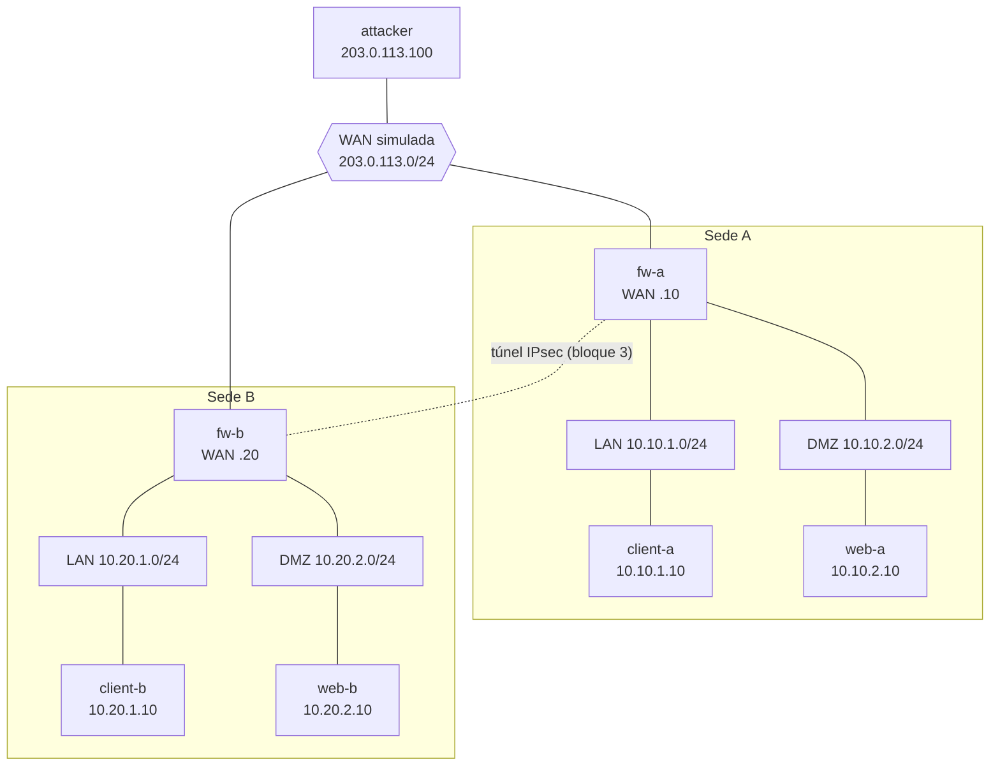

# Laboratorio de segmentación y firewall / Segmentation and firewall lab

**ES:** Laboratorio reproducible con Docker que recrea una arquitectura de dos sedes con zonas (LAN y DMZ), firewalls Linux (nftables) y un túnel IPsec (strongSwan), validado con un contenedor atacante (nmap). Todo corre aislado, sin salida a internet.

**EN:** Reproducible Docker lab that recreates a two-site architecture with zones (LAN and DMZ), Linux firewalls (nftables) and an IPsec tunnel (strongSwan), validated with an attacker container (nmap). Everything runs isolated, with no internet access.

## Estado / Status

- [x] Bloque 1: topología base (redes, contenedores, enrutamiento) / Base topology
- [ ] Bloque 2: política del firewall con nftables (denegar por defecto) / Default-deny firewall policy
- [ ] Bloque 3: túnel IPsec entre sedes / Site-to-site IPsec tunnel
- [ ] Bloque 4: pruebas con nmap y evidencias / nmap validation and evidence

## Topología / Topology

| Zona | Red | Equipos |
|---|---|---|
| WAN simulada | 203.0.113.0/24 | fw-a (.10), fw-b (.20), attacker (.100) |
| Sede A, LAN | 10.10.1.0/24 | client-a (.10), fw-a (.254) |
| Sede A, DMZ | 10.10.2.0/24 | web-a (.10), fw-a (.254) |
| Sede B, LAN | 10.20.1.0/24 | client-b (.10), fw-b (.254) |
| Sede B, DMZ | 10.20.2.0/24 | web-b (.10), fw-b (.254) |



## Uso / Usage

```powershell
docker compose up -d --build
docker compose ps
docker compose down        # detener y eliminar el laboratorio
```

## Verificación del bloque 1 / Block 1 checks

```powershell
docker exec fw-a ip -br addr
docker exec fw-a cat /proc/sys/net/ipv4/ip_forward      # 1
docker exec client-a ping -c 2 10.10.1.254              # llega a su firewall (OK)
docker exec client-a ping -c 2 10.10.2.10               # LAN -> DMZ pasa por fw-a (OK, aún sin reglas)
docker exec client-a ping -c 2 10.20.1.10               # otra sede: debe FALLAR hasta tener el túnel
docker exec attacker ping -c 2 203.0.113.10             # atacante ve el firewall (OK)
docker exec attacker ping -c 2 10.10.2.10               # atacante a la DMZ: debe FALLAR
```

## Aprendizajes / Lessons learned

- **Docker `internal: true` no sirve para enrutar entre zonas con un firewall en contenedor.** Con redes internas, el ping de la LAN a la DMZ a través de `fw-a` fallaba y `tcpdump` en el firewall no veía ni la petición: el paquete se descartaba antes de llegar, aunque el firewall no tenía reglas. Solución: redes normales con NAT desactivado y sin rutas por defecto en firewalls y atacante.
- _TODO: completar al terminar cada bloque / fill in as each block is completed._

